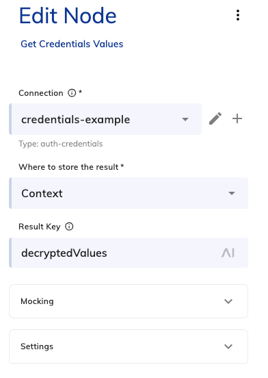
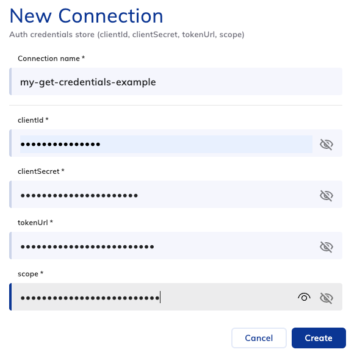
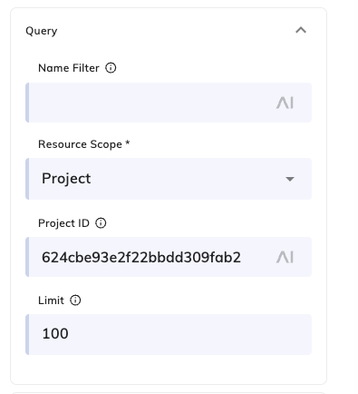

# Connection Management

A Cognigy Extension for working with [Connections](https://docs.cognigy.com/ai/platform-features/connections)
from within a Flow, read their decrypted values, update the values inside them,
and list them. Handy for storing and rotating auth tokens and other credentials.

## What's new in 5.0.0

- **Update multiple connections at once.** The Update nodes' **Connection
  ID(s)** field now accepts a comma-separated list of `_id`s, so every copy of
  a connection can be updated in one step (see
  [Snapshots change connection IDs](#snapshots-change-connection-ids)).
- **Per-connection results.** If one update fails, the rest still run, and the
  result lists what was updated and what failed.
- **Breaking change:** the Update nodes used to store the API response for the
  single connection. They now store a summary
  (`total`, `updatedCount`, `failedCount`, `updated`, `failed`). Flows that read
  values from the old result need updating.

## Connection schemas

This extension defines three connection schemas.

| Schema | `type` | Fields |
| ------ | ------ | ------ |
| Token store | `auth-token` | `accessToken`, `expiresAt`, `refreshToken` |
| Credentials store | `auth-credentials` | `clientId`, `clientSecret`, `tokenUrl`, `scope` |
| Data store | `auth-data` | `value1` … `value6` (free-form slots) |

Any values passed into the connection need to be `strings`, even numbers, otherwise the values will not pass into the connections properly.  As an example, below is an example of setting up some values for a Data node update.

```
  const now = Date.now();

  const data = {
    Value1: `value1-${now}`,
    Value2: `${now}`,
    Value3: `https://cognigy.ai/v1/example?ts=${now}`,
    Value4: `${now % 2 === 0}`,
    Value5: `${Math.round((now % 1000) / 10)}`,
    Value6: `data-${now}`
  };

  api.addToContext('data', data, 'simple');
```

## How it works

Two mechanisms, because Cognigy exposes connections two ways:

1. **Connection binding**: A connection *field* on a node. At runtime Cognigy
   injects the connection's **decrypted** values into the node. This is the only way to read real secret values.  Used by the **Get … Values** nodes. No API key needed.
2. **Management REST API**: For updating, listing, and inspecting connections.
   Authenticated with a Cognigy API key stored in the `cognigy-api` Connection.  Note the API **masks secret values as `****`** in responses which is why we can't also use this for getting connection values or why we can't use a standard HTTP request to get connection values.

### Prerequisites (for the API-based nodes)

- A **Cognigy API key** with permission to manage Connections.
- The **base URL** of your Cognigy API (e.g. `https://api-trial.cognigy.ai`).

Both live in this extension's `cognigy-api` Connection. The API-based nodes need
the connection's Mongo `_id` (24-hex), **not** the `referenceId` (UUID) — use
**List Connections** to discover it.

## Nodes

### Get Token Values / Get Credentials Values / Get Data Values

Read a connection via a **binding** — pick the connection on the node (or create
one with `+`) and its **decrypted** values are written to `input`/`context`. Use
these whenever the flow needs real values (`accessToken`, `clientSecret`, …).

### List Connections

Returns connections to `input`/`context`: a `connections` summary and a full
`items` array, each with the Mongo `_id` injected. Optional name filter and
project/organisation scope. Use it to discover the `_id` for the Update nodes.

### Read Connection (metadata — secrets masked)

Reads a connection by `_id` via the API. Secret values come back masked as
`****`, so use it for metadata inspection; use the Get … Values nodes for real
values.

### Update Token / Update Credentials / Update Data Connection

Write values into a connection by `_id` via `PATCH /v2.0/connections/{id}`. Each
node shows the target schema's **named fields** — fill only the ones you want to
change (blanks are skipped). Requires the `cognigy-api` Connection and the
connection's `_id`.

The **Connection ID(s)** field takes a single `_id` or a comma-separated list
(e.g. `6a886d4bd9adb69ed8d18eba,6abe15c1eec04a04502a05b4`) — useful when
snapshot restores have created duplicate connections that all need the same
values. A CognigyScript array such as `{{input.connectionIds}}` also works. The
same values are written to every id, in a random order each run; if one fails,
the rest still run. The random order means that if a run is cut short (e.g. by
the extension's runtime limit), a later refresh is likely to reach the ids that
were missed. The result looks like:

```json
{
  "total": 2,
  "updatedCount": 1,
  "failedCount": 1,
  "updated": [{ "id": "6a886d4bd9adb69ed8d18eba", "status": 200 }],
  "failed": [{ "id": "6abe15c1eec04a04502a05b4", "error": "HTTP 404: Not found" }]
}
```

Partial failures are logged and the flow continues — check `failedCount`. If
**every** update fails (or no id is given), the node follows **On Error**: stop
execution, or store the result with an added `error` message.

## Step-by-step guide

### Initial setup & reading

Create a **Get … Values** node and, within it, create a new connection (via the
`+` next to the Connection field) to read from:



Creating a connection opens a form for its fields:



You can also choose where the decrypted values are stored (`Input` or
`Context`) and under what `Result Key`.

> Future idea: allow selecting the connection by ID instead of a fixed
> binding, so a single node could be reused across multiple environments.

Once configured, running the node retrieves the decrypted values so they can
be passed into a subsequent node — for example, into an HTTP Request's headers
or body.

### Updating

Updating takes an extra step: you first need the connection's `_id`. Both this
lookup and the update itself require a `cognigy-api` Connection (an API key).

#### Snapshots change connection IDs

**Don't hardcode connection `_id`s.** When you restore a snapshot to your
Agent, the restored connections get new `_id`s, and the restore can leave
duplicate copies of the same connection (same name, different `_id`). A
hardcoded `_id` will then point at the wrong connection, or at one that no
longer exists, and you won't know which copy the flow is reading from.

Instead, look the `_id`s up at runtime and update **every** matching copy:

1. **List Connections**: set **Name Filter** to the connection's name and
   **Project ID** to your project, so only the copies of that connection come
   back. Make the name specific enough that it can't match other connections.
   With the default settings, the results are stored in `input.connections`.

   

2. **Code node**: turn the results into a comma-separated list of `_id`s:

   ```js
   /**
    * Node Name: Code: Get Connection IDs
    * Description: Grabs connection IDs from filtered list.
    * Author: Daniel Tucker
    * Created On: 2026-10-12
    * Last Modified: 2026-10-12
   */

   // Filtered connections returned by the previous node
   const items = input.connections?.items;

   // Only proceed if there is at least one connection to process
   if (items && items.length > 0) {
       // Pull out each _id and join them into a comma-separated string
       const connectionList = items.map(item => item._id).join(', ');

       // Store the IDs in context for use by later nodes
       api.addToContext('temp.connectionList', connectionList, 'simple');
   }
   ```

3. **Update … Connection**: set **Connection ID(s)** to
   `{{context.temp.connectionList}}` and fill in the new field values. Every
   connection in the list gets the same values.

## Example: token refresh loop

1. **Get Token Values** → read `accessToken` + `expiresAt` (decrypted).
2. Check whether the token is expired.
3. If expired: **Get Credentials Values** → read `clientId`/`clientSecret`/`tokenUrl`.
4. **HTTP Request** node → call the token endpoint for a new token.
5. **List Connections** + **Code node** → collect the `_id`s of every copy of
   the token connection (see [Updating](#updating)).
6. **Update Token Connection** → write the new `accessToken` + `expiresAt` to
   all of them.

## Known limitations & notes

- **`PATCH` merge vs. replace**: The Update nodes send only the fields you fill
  in meaning that blank fields should not be updated.
- **Snapshot restores** give connections new `_id`s and can create duplicate
  copies. Look the `_id`s up at runtime rather than hardcoding them (see
  [Snapshots change connection IDs](#snapshots-change-connection-ids)).
- Connections created via the `+` button are made at **design time**; there is
  no runtime/programmatic connection creation.
- The API key in the `cognigy-api` Connection grants connection-management
  rights — scope it as narrowly as your tenant allows.

## Build

```bash
npm install
npm test           # run the unit tests (Node's built-in test runner)
npm run build      # transpile + lint + package into a .tar.gz
```

The resulting archive can be uploaded to Cognigy as a custom Extension.
